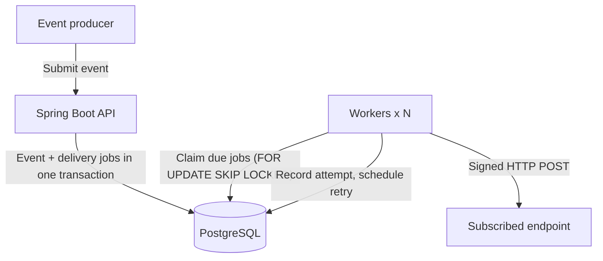

# Webhook Relay

A webhook delivery service built with Java 21, Spring Boot, and PostgreSQL.

Webhook Relay stores events from a producer and delivers them to subscribed HTTP endpoints with retries, worker recovery, and request signing. PostgreSQL serves as both the event store and the work queue, so an event and its delivery jobs can be written in a single transaction without a separate message broker.

> **Status: In development.** The application foundation, local PostgreSQL environment, and database schema are complete. Event ingestion and webhook delivery are the next steps. There is no deployed demo yet.

## What's implemented

- **Application:** Spring Boot with Web, Validation, and Actuator; separate `local` and `test` profiles; local credentials supplied through environment variables.
- **Database:** PostgreSQL 17 in Docker Compose with a named volume, a readiness healthcheck, and localhost-only port binding.
- **Schema:** Flyway-versioned migrations creating four tables with primary keys, foreign keys, uniqueness rules, CHECK constraints, and partial indexes for the job queue.
- **Workflow:** Gradle Wrapper, GitHub Actions build, pull-request workflow with a PR template, main branch protection, and Dependabot.

The schema already includes columns for idempotency, retries, signing secrets, and worker leases. The application logic that uses them is planned.

## Technology

| Area | Current implementation |
| --- | --- |
| Language | Java 21 |
| Framework | Spring Boot 4.1.1 |
| Build | Gradle Wrapper |
| Database access | Spring JDBC, PostgreSQL JDBC driver |
| Database | PostgreSQL 17 |
| Schema migrations | Flyway |
| Local infrastructure | Docker Compose |
| Health endpoint | Spring Boot Actuator |
| Testing | Spring Boot context smoke test (H2) |
| CI | GitHub Actions |

**Planned:** Spring Data JPA for entities and repositories, Testcontainers, WireMock, Micrometer/Prometheus, k6, and an HTTPS deployment with Docker Compose.

## Delivery architecture (planned)



1. The API stores an event and one delivery job per subscribed endpoint in a single transaction.
2. Workers claim due jobs with `SELECT ... FOR UPDATE SKIP LOCKED`, so multiple workers can poll the same table without claiming the same job.
3. Each claim sets a lease. If a worker crashes, the lease expires and the job becomes eligible for recovery.
4. Workers send the signed request, record the attempt, and either mark the job complete or schedule a retry.

### Delivery guarantee

The target is **at-least-once delivery**. A receiver may process a request before the worker records success, so a retry can deliver the same event again. Receivers should deduplicate using the stable event ID. Database uniqueness on jobs cannot guarantee exactly-once processing at the receiver.

## Data model

| Table | Purpose |
| --- | --- |
| `endpoints` | Destination URL, signing secret, subscribed event types, active flag, optional rate limit |
| `events` | Event type, JSON payload, optional idempotency key, creation time |
| `deliveries` | One event-to-endpoint job: status, attempt count, retry schedule, lease, latest outcome |
| `delivery_attempts` | Per-attempt HTTP status or transport error, duration, start time |

One event has many deliveries; one delivery has many attempts.

**Integrity rules enforced by the database**

- Idempotency keys are unique when present; events without a key are allowed.
- One delivery job per `(event_id, endpoint_id)` pair.
- One attempt record per `(delivery_id, attempt_no)` pair.
- Payloads must be JSON objects, stored as `jsonb`.
- Delivery status is one of `PENDING`, `IN_PROGRESS`, `SUCCEEDED`, or `DEAD`.
- A lease timestamp is required for `IN_PROGRESS` and must be empty for every other status.
- Attempt counters, HTTP status codes, and durations must fall within valid ranges.

These rules protect stored data. API-level idempotency and worker state transitions will be enforced in application code.

**Indexes**

| Index | Query it supports |
| --- | --- |
| `(next_attempt_at, id) WHERE status = 'PENDING'` | Find due pending deliveries |
| `(locked_until, id) WHERE status = 'IN_PROGRESS'` | Find expired worker leases |
| `(endpoint_id)` | List deliveries for an endpoint |

The partial indexes keep completed delivery history out of the active-job indexes. Their performance has not been benchmarked yet.

## Design decisions

**PostgreSQL as both store and queue.** Writing events and jobs to the same database makes transactional enqueueing possible without a separate broker. The tradeoff is polling overhead and extra database load, which will need to be measured under realistic workloads.

**Flyway owns the schema.** Applied migrations are never edited, and every schema change goes into a new version so the schema history stays reproducible. When JPA entities are added, Hibernate will run with `ddl-auto=validate`: it checks that the entities match the schema but never changes it.

**Text status with a CHECK constraint.** The database rejects unknown statuses, and new states can be added through an explicit migration. Valid transitions between states are enforced in application code.

**Sign the bytes that are sent.** `jsonb` normalizes JSON and does not keep the original bytes, so the sender will compute the signature over the exact serialized body it transmits, not over the stored payload.

## Run locally

**Prerequisites:** JDK 21, Git, and Docker with Compose (engine running). Ports `5432` and `8080` should be free. Commands use macOS/Linux shell syntax. PostgreSQL runs in Docker; the application runs on the host.

### 1. Clone and configure

```bash
git clone https://github.com/fxtiion-sys/webhook-relay.git
cd webhook-relay
cp .env.example .env
```

Replace the password placeholder in `.env` with a local development password. Keep the file shell-compatible, because it is sourced in step 3.

```dotenv
POSTGRES_DB=webhook_relay
POSTGRES_USER=relay
POSTGRES_PASSWORD=replace_with_local_password
POSTGRES_PORT=5432
APP_PORT=8080
```

`.env` is ignored by Git. If a database volume already exists, changing `POSTGRES_PASSWORD` does not change the stored user's password.

### 2. Start PostgreSQL

```bash
docker compose config --quiet
docker compose up -d postgres
docker compose ps
```

Wait until the `postgres` service reports `healthy`.

### 3. Start the application

```bash
set -a
source .env
set +a
./gradlew bootRun --args='--spring.profiles.active=local'
```

Docker Compose reads `.env` on its own, but the application on the host needs the values exported. Repeat the export in every new terminal.

Flyway applies migrations on startup. On a fresh database, `V1` initializes the migration history and `V2` creates the four tables.

### 4. Check health

```bash
curl http://localhost:8080/actuator/health
```

The response should report `UP`. API examples will be added with the event and endpoint APIs.

### 5. Stop

Stop the application with `Ctrl+C`, then:

```bash
docker compose stop
```

The database volume is kept. `docker compose down -v` deletes it along with all data.

## Testing

```bash
./gradlew test
./gradlew build
```

The current automated test is a context smoke test using the `test` profile and H2. Flyway is disabled in that profile, so it does **not** cover the PostgreSQL migrations or PostgreSQL-specific behaviour.

Verified manually so far:

- Application startup, database connectivity, and an `UP` health response.
- Flyway `V1` and `V2` recorded in `flyway_schema_history`; an applied migration is not rerun after restart.
- Tables, constraints, and indexes inspected with `psql`.

PostgreSQL integration tests, receiver-failure and worker-recovery tests, and load measurements are planned. No throughput or latency numbers are published yet.

## Roadmap

- [x] Spring Boot foundation, CI, and repository workflow
- [x] Local PostgreSQL with Docker Compose
- [x] Database schema, constraints, and indexes with Flyway
- [ ] PostgreSQL integration tests with Testcontainers
- [ ] Endpoint registration and event ingestion with transactional job creation
- [ ] API-level idempotency
- [ ] HTTP delivery with concurrent worker claiming
- [ ] Exponential backoff with jitter, terminal `DEAD` state, and manual replay
- [ ] Lease recovery and ownership checks for stale worker results
- [ ] HMAC-SHA256 request signatures with timestamps
- [ ] Delivery metrics and reproducible k6 results
- [ ] Receiver-outage and worker-crash tests
- [ ] Delivery history UI and HTTPS demo deployment

**Out of scope for now:** Kafka/SQS, Kubernetes, a client SDK, and multi-tenant authentication.

Progress is tracked in [Issues](https://github.com/fxtiion-sys/webhook-relay/issues) and [Milestones](https://github.com/fxtiion-sys/webhook-relay/milestones).
