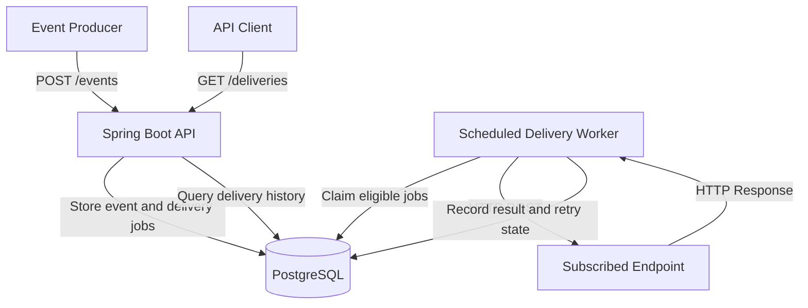

# Webhook Relay

A webhook delivery service built with Java 21, Spring Boot, and PostgreSQL.

Webhook Relay accepts events, creates delivery jobs for subscribed HTTP endpoints, and processes them asynchronously using a database-backed worker. PostgreSQL acts as both the event store and the work queue, enabling transactional event ingestion without a separate message broker.

> **Status: v0.3 — Observability & Tests.** Webhook Relay includes reliable asynchronous delivery, retry policies, dead-letter handling, replay, event idempotency, HMAC-SHA256 signing, per-endpoint rate limiting, Prometheus metrics, and structured worker logging. Local load testing, multi-worker scalability validation, receiver-outage recovery, and real JVM worker-crash recovery have been completed. All 107 automated tests pass. A public deployment is not yet available.

## What's implemented

- **Application:** Spring Boot 4.1.1 with REST APIs, Bean Validation, Actuator, and separate `local` and `test` profiles.
- **Database:** PostgreSQL 17 managed through Docker Compose, with Flyway migrations and Spring Data JPA.
- **Endpoint registration:** Register HTTP endpoints and subscribe them to event types.
- **Event ingestion:** Accept events and create delivery jobs for subscribed endpoints within a database transaction.
- **Delivery worker:** Poll for eligible deliveries, claim jobs using `FOR UPDATE SKIP LOCKED`, and send HTTP POST requests.
- **Retry and recovery:** Retry transient failures using capped exponential backoff with full jitter, reclaim expired leases, and reject stale worker results.
- **Failure classification:** Distinguish retryable HTTP/server/transport failures from terminal errors; move exhausted or non-retryable deliveries to `DEAD`.
- **Replay:** Manually replay dead-letter deliveries through `POST /deliveries/{id}/replay` with replay-specific attempt accounting.
- **Event idempotency:** Accept an idempotency key to prevent duplicate event creation and detect conflicting reuse.
- **Webhook authentication:** Sign outgoing requests with HMAC-SHA256 and verify signatures with a timestamp freshness window and constant-time comparison. The local demo receiver selects the correct endpoint secret using the delivery ID.
- **Rate limiting:** Apply per-endpoint token-bucket limits and defer deliveries when capacity is exhausted without issuing an HTTP request.
- **Delivery history API:** List deliveries with status filtering, endpoint filtering, and pagination; retrieve individual deliveries with their attempt history.
- **Testing:** JUnit 5, Testcontainers, WireMock Standalone, and Awaitility tests covering database integrity, concurrency, retries, HTTP timeouts, terminal failures, signing, and rate limiting.
- **Local demo:** `scripts/demo.sh` demonstrates endpoint registration, event publishing, worker processing, and delivery history retrieval; the local mock receiver resolves endpoint-specific HMAC secrets by delivery ID.
- **Development workflow:** Gradle Wrapper, GitHub Actions, pull requests, branch protection, and Dependabot.
- **Observability:** Actuator health and Prometheus endpoints, committed delivery outcome counters, HTTP and end-to-end latency histograms, and a periodically refreshed pending-delivery gauge.
- **Load testing and scalability:** Reproducible k6 workloads, SQL-based delivery verification, and single-worker versus multi-worker benchmarks. Horizontal worker scaling reduced observed p95 end-to-end delivery latency by 96.7% while maintaining a 100% delivery success rate across 1,201 events.
- **Receiver-outage recovery:** Automated integration testing and a reproducible failure-recovery script using an independent Python HTTP receiver. All 10 events accepted during a local receiver outage were successfully delivered after recovery, with zero missing or dead deliveries.
- **Worker-crash recovery:** Reproducible process-level fault injection using independent JVM workers, SIGKILL, and natural lease expiration. An abandoned delivery was successfully recovered by a second worker without premature reclaim, with consistent attempt history and verified duplicate HTTP reception.

## Current limitations

- No publicly deployed demo.

- Load testing has been completed in a local environment using a mock receiver. Production-scale performance and maximum sustainable throughput have not been established.

- Grafana dashboards and alerting rules are not yet configured.

- Temporary receiver-outage recovery and worker-crash recovery have been validated locally. Prolonged receiver outages, additional network-fault scenarios, and simultaneous infrastructure failures remain to be validated.

- The system follows an at-least-once delivery model. Duplicate HTTP requests are possible, and receivers must implement idempotent processing to prevent duplicate business side effects.

## Technology

| Area | Current implementation |
| --- | --- |
| Language | Java 21 |
| Framework | Spring Boot 4.1.1 |
| Build | Gradle Wrapper |
| Database access | Spring Data JPA, Spring JDBC, PostgreSQL JDBC driver |
| Database | PostgreSQL 17 |
| Schema migrations | Flyway |
| Local infrastructure | Docker Compose |
| Observability | Spring Boot Actuator, Micrometer, Prometheus exporter, Prometheus server (Docker Compose) |
| Testing | JUnit 5, Spring Boot Test, Testcontainers (PostgreSQL 17), WireMock Standalone, Awaitility |
| CI | GitHub Actions |
| Load testing | k6, PostgreSQL verification scripts |
| Failure-recovery testing | Bash, Python 3 standard library, curl, jq, WireMock, Awaitility |

**Planned:** Grafana dashboards, alerting rules, additional failure-recovery testing, and a public HTTPS deployment.

## Delivery architecture



### Delivery workflow

1\. **Endpoint registration:** Clients register an HTTP endpoint and subscribe to event types using `POST /endpoints`.

2\. **Event ingestion:** Producers publish events through `POST /events`. The application stores the event and creates delivery jobs for matching endpoints in a database transaction.

3\. **Worker polling:** A scheduled worker periodically queries PostgreSQL for eligible deliveries.

4\. **Concurrent claiming:** Workers use `SELECT ... FOR UPDATE SKIP LOCKED` to claim available jobs without claiming the same job concurrently.

5\. **HTTP delivery:** The worker sends an HTTP POST request to the registered endpoint.

6\. **Result recording:** Successful responses mark the delivery as `SUCCEEDED`. Failed attempts are recorded and eligible deliveries are scheduled for retry.

7\. **Lease recovery:** Expired worker leases allow interrupted deliveries to be reclaimed. Ownership checks prevent stale workers from overwriting newer results.

8\. **Delivery inspection:** Clients can retrieve delivery status, pagination results, and attempt history using the delivery query APIs.

### Delivery guarantee

The system follows an **at-least-once delivery model**.

A receiver may process a webhook before the worker records the successful result. If the worker crashes during this interval, the delivery can be retried.

Therefore, receivers should implement idempotent processing to handle duplicate webhook deliveries safely.

### Concurrency and reliability

- **Database-backed queue:** PostgreSQL stores both events and delivery jobs.

- **Row-level locking:** `FOR UPDATE SKIP LOCKED` enables concurrent workers to claim different jobs.

- **Lease-based recovery:** Expired leases allow unfinished work to be reclaimed.

- **Fencing checks:** Stale worker results are rejected when ownership has changed.

- **Attempt history:** HTTP status codes, errors, and durations are recorded for delivery inspection.

Worker concurrency, active lease protection, expired-lease recovery, and stale-result rejection are covered by PostgreSQL integration tests using Testcontainers.

Process-level recovery has also been validated by terminating a real JVM worker during an in-flight HTTP request and recovering the abandoned delivery through an independent worker after natural lease expiration.

## Data model

| Table | Purpose |
| --- | --- |
| `endpoints` | Destination URL, signing secret, subscribed event types, active flag, optional rate limit |
| `events` | Event type, JSON payload, optional idempotency key, creation time |
| `deliveries` | One event-to-endpoint job: status, attempt count, retry schedule, lease, latest outcome |
| `delivery_attempts` | Per-attempt HTTP status or transport error, duration, result-recording time |

One event has many deliveries; one delivery has many attempts.

**Integrity rules enforced by the database**

- Idempotency keys are unique when present; events without a key are allowed.

- One delivery job per `(event_id, endpoint_id)` pair.

- One attempt record per `(delivery_id, attempt_no)` pair.

- Payloads must be JSON objects, stored as `jsonb`.

- Delivery status is one of `PENDING`, `IN_PROGRESS`, `SUCCEEDED`, or `DEAD`.

- A lease timestamp is required for `IN_PROGRESS` and must be empty for every other status.

- Attempt counters, HTTP status codes, and durations must fall within valid ranges.

These rules protect stored data. API-level idempotency and valid worker state transitions are also enforced in application code.

**Indexes**

| Index | Query it supports |
| --- | --- |
| `(next_attempt_at, id) WHERE status = 'PENDING'` | Find due pending deliveries |
| `(locked_until, id) WHERE status = 'IN_PROGRESS'` | Find expired worker leases |
| `(endpoint_id)` | List deliveries for an endpoint |

The partial indexes keep completed delivery history out of the active-job indexes. Their performance has not been benchmarked yet.

## Design decisions

**PostgreSQL as both store and queue.** Writing events and jobs to the same database makes transactional enqueueing possible without a separate broker. The tradeoff is polling overhead and extra database load, which will need to be measured under realistic workloads.

**Flyway owns the schema.** Applied migrations are never edited, and every schema change goes into a new version so the schema history stays reproducible. Hibernate runs with `ddl-auto=validate`, checking that JPA entities match the schema without modifying it.

**Text status with a CHECK constraint.** The database rejects unknown statuses, and new states can be added through an explicit migration. Valid transitions between states are enforced in application code.

**Sign the bytes that are sent.** `jsonb` normalizes JSON and does not preserve original input bytes. The sender signs the serialized body it actually transmits; verification uses the raw HTTP request bytes. The signature includes a timestamp and is checked with a ±5-minute freshness window.

## Run locally

**Prerequisites:** JDK 21, Git, and Docker with Compose (engine running). Ports `5432` and `8080` should be free. Commands use macOS/Linux shell syntax. PostgreSQL runs in Docker; the application runs on the host.

### 1. Clone and configure

```bash

git clone https://github.com/fxtiion-sys/webhook-relay.git

cd webhook-relay

cp .env.example .env

```

Replace the password placeholder in `.env` with a local development password. Keep the file shell-compatible, because it is sourced in step 3.

```dotenv

POSTGRES_DB=webhook_relay

POSTGRES_USER=relay

POSTGRES_PASSWORD=replace_with_local_password

POSTGRES_PORT=5432

APP_PORT=8080

```

`.env` is ignored by Git. If a database volume already exists, changing `POSTGRES_PASSWORD` does not change the stored user's password.

### 2. Start PostgreSQL

```bash

docker compose config --quiet

docker compose up -d postgres

docker compose ps

```

Wait until the `postgres` service reports `healthy`.

### 3. Start the application

```bash

set -a

source .env

set +a

./gradlew bootRun --args='--spring.profiles.active=local'

```

Docker Compose reads `.env` on its own, but the application on the host needs the values exported. Repeat the export in every new terminal.

Flyway applies migrations on startup. On a fresh database, Flyway applies the versioned migrations, including the initial schema and delivery attempt-base migration (`V3`).

### 4. Check health

```bash

curl http://localhost:8080/actuator/health

```

The response should report `UP`. Use the API examples below to register an endpoint and publish an event.

### 5. Run the end-to-end demo

The demo script creates an endpoint, publishes an event, waits for the delivery worker, and retrieves the delivery result and attempt history.

**Prerequisites:** The application and PostgreSQL must be running. Install `curl` and `jq` before running the demo.

**Local HMAC verification:** In the `local` profile, the built-in mock receiver uses the incoming `Webhook-Id` (the delivery UUID) to look up that delivery and resolve its endpoint-specific signing secret. This allows endpoints created by the registration API to work with the demo without manually synchronizing secrets. Valid signatures are accepted; invalid signatures and unknown delivery IDs return HTTP `401`. This database-backed secret lookup is enabled only in the `local` profile; outside that profile, the receiver uses the configured `app.mock-receiver.secret`.

The end-to-end demo has been verified to complete with a `SUCCEEDED` delivery, one attempt, and HTTP `200`. This receiver is a development/testing aid, not a production webhook receiver.

```bash

chmod +x scripts/demo.sh

./scripts/demo.sh

```

The script performs the following steps:

1\. Registers a webhook endpoint using `POST /endpoints`.

2\. Publishes an event using `POST /events`.

3\. Waits for the delivery worker to process the event.

4\. Retrieves the delivery status and attempt history.

The following output illustrates the successful local demo flow.

Expected output:

```text

\=== Webhook Relay Demo ===

[1/4] Creating endpoint...

Endpoint ID: <generated-uuid>

[2/4] Publishing event...

Event ID: <generated-uuid>

[3/4] Waiting for delivery...

Delivery ID: <generated-uuid>

Status: SUCCEEDED

[4/4] Fetching delivery details...

{

  "delivery": {

    "status": "SUCCEEDED",

    "attemptCount": 1,

    "lastStatusCode": 200

  },

  "attempts": [

    {

      "attemptNo": 1,

      "statusCode": 200

    }

  ]

}

\=== Demo completed successfully ===

```

The JSON shown above is abbreviated. Actual responses also include IDs, timestamps, and other delivery metadata.

### 6. API endpoints

| Method | Endpoint | Description |
| --- | --- | --- |
| POST | `/endpoints` | Register a webhook endpoint |
| GET | `/endpoints/{id}` | Retrieve endpoint information |
| POST | `/events` | Publish an event and create delivery jobs |
| GET | `/deliveries` | List deliveries with optional filters and pagination |
| GET | `/deliveries/{id}` | Retrieve a delivery and its attempt history |
| POST | `/deliveries/{id}/replay` | Replay an eligible dead-letter delivery |
| POST | `/mock-receiver` | Local receiver for testing HTTP delivery |
| GET | `/actuator/health` | Check application health |
| GET | `/actuator/prometheus` | Export application and custom delivery metrics |

#### Create an endpoint

```bash

curl -X POST http://localhost:8080/endpoints \\

  -H "Content-Type: application/json" \\

  -d '{

    "url": "http://localhost:8080/mock-receiver",

    "eventTypes": ["order.created"]

  }'

```

With the `local` profile active, the mock receiver resolves the signing secret from the delivery ID and its associated endpoint. No manual secret synchronization or application restart is needed after endpoint registration. In other profiles, the receiver uses the configured `app.mock-receiver.secret` instead.

#### Publish an event

```bash

curl -X POST http://localhost:8080/events \\

  -H "Content-Type: application/json" \\

  -d '{

    "type": "order.created",

    "payload": {

      "orderId": 123

    }

  }'

```

#### List deliveries

```bash
curl "http://localhost:8080/deliveries?page=0&size=10"
```

Filter by status:

```bash
curl "http://localhost:8080/deliveries?status=SUCCEEDED"
```

Filter by endpoint:

```bash
curl "http://localhost:8080/deliveries?endpointId=<endpoint-uuid>"
```

#### Retrieve delivery details

```bash
curl "http://localhost:8080/deliveries/<delivery-uuid>"
```

The response includes delivery metadata and an `attempts` array ordered by attempt number.

### 7. Stop

Stop the Spring Boot application with `Ctrl+C`, then run:

```bash
docker compose stop
```

The database volume is preserved. Running `docker compose down -v` deletes the database volume and its data.

## Observability

Available at `/actuator/prometheus`:

| Metric | Meaning |
| --- | --- |
| `webhook_delivery_attempts_total` | Committed attempt outcomes, labeled by `result`: success, retry, or dead |
| `webhook_delivery_duration_seconds` | HTTP attempt duration, including failed calls |
| `webhook_delivery_e2e_latency_seconds` | Time from event creation to successful delivery commit, measured per delivery |
| `webhook_deliveries_pending` | Current PENDING deliveries, including scheduled retries; refreshed every 5 seconds |

Both timers publish histogram buckets, counts, and sums.

Result counters and E2E measurements are recorded after transaction commit.
Rolled-back and stale results do not increment them. HTTP timing records
performed calls even when their results are later rejected as stale.

The pending gauge starts as NaN until its first successful database query.
A refresh failure retains the previous value. When multiple app instances
observe the same database, do not sum their pending gauges.

Metrics use bounded labels rather than endpoint IDs, delivery IDs, or URLs.
Counters reset on application restart and are operational measurements,
not a durable audit log. Lease-expiry cleanup does not increment the
attempt-outcome counter. E2E latency includes only successful deliveries;
a replay retains the original event creation time.

### Local Prometheus monitoring

Prometheus runs in Docker Compose while Spring Boot runs on the host machine. The Prometheus container scrapes `host.docker.internal:8080/actuator/prometheus` every 15 seconds.

Start the application using the local setup instructions above, then start Prometheus:

```bash
docker compose config --quiet
docker compose up -d prometheus
docker compose ps
curl -fsS http://localhost:9090/-/ready
```

Open `http://localhost:9090/targets` and confirm that the `webhook-relay` target reports `UP`. The Prometheus query UI is available at `http://localhost:9090/query`.

The Prometheus UI is bound to `127.0.0.1:9090` for local development. Prometheus data is stored in the named `prometheus_data` Docker volume.

### Example PromQL queries

| Question | PromQL |
| --- | --- |
| Successful attempts (cumulative) | `webhook_delivery_attempts_total{result="success"}` |
| Dead attempts (cumulative) | `webhook_delivery_attempts_total{result="dead"}` |
| Successes over the last 5 minutes | `increase(webhook_delivery_attempts_total{result="success"}[5m])` |
| Successful attempts per second | `rate(webhook_delivery_attempts_total{result="success"}[5m])` |
| Estimated HTTP attempt duration p95 | `histogram_quantile(0.95, sum by (le) (rate(webhook_delivery_duration_seconds_bucket[5m])))` |
| Successful E2E latency measurements | `webhook_delivery_e2e_latency_seconds_count` |
| Pending deliveries | `webhook_deliveries_pending` |

The p95 query estimates HTTP attempt latency from histogram buckets; it does not measure end-to-end latency. Small samples are not sufficient for performance benchmarking. Counter values are cumulative within an application process and may reset on restart.

### Monitoring troubleshooting

- **Target DOWN:** Confirm the application is running on port 8080 and that `/actuator/prometheus` responds. `host.docker.internal` lets the Docker Desktop container reach the host application.
- **No recent query results:** Check the selected time range and whether requests occurred within the PromQL lookback window.
- **No E2E latency observations:** This metric records successful deliveries only.
- **HTTP 401 from the demo receiver:** Confirm the application is running with the `local` profile and the request has a valid delivery UUID in `Webhook-Id`, a current `Webhook-Timestamp`, and an HMAC signature generated using that delivery endpoint’s secret. Unknown delivery IDs, missing headers, invalid signatures, and expired timestamps are rejected. Do not disable signature verification as a workaround.

## Performance benchmarks

Local load testing with k6 evaluated event ingestion performance, asynchronous delivery reliability, and horizontal worker scalability.

### Single-worker vs. multi-worker

Both configurations were tested at 20 events per second for 60 seconds using the same PostgreSQL-backed delivery queue.

| Metric | Single-worker | Multi-worker |
| --- | ---: | ---: |
| Workers | 1 | 2 |
| Published events | 1,201 | 1,201 |
| Successful deliveries | 1,201 | 1,201 |
| Delivery success rate | 100% | 100% |
| API p95 latency | 17.46 ms | 17.39 ms |
| Average E2E latency | 8,555.02 ms | 321.41 ms |
| E2E p95 latency | 16,045.88 ms | 531.41 ms |
| Retries | 0 | 0 |
| Dead deliveries | 0 | 0 |

Adding a second worker reduced observed p95 end-to-end delivery latency by **96.7%**, without modifying the Java implementation.

The two workers processed 623 and 578 deliveries respectively, demonstrating near-even workload distribution through the shared PostgreSQL queue.

Across all four local test runs, **2,564 out of 2,564 deliveries succeeded**, with no recorded retries or dead deliveries.

### Reproduce the benchmark

With k6 installed and the application running:

```bash
k6 run -e RATE=20 -e DURATION=60s scripts/load-test.js
```

Verify delivery outcomes and latency using PostgreSQL:

```bash
docker compose exec -T postgres sh -c \
  'psql -v ON_ERROR_STOP=1 -U "$POSTGRES_USER" -d "$POSTGRES_DB"' \
  < scripts/load-test-results.sql
```

These results represent individual local benchmark runs using a mock receiver. End-to-end latency is approximated using database timestamps. The results do not establish production performance guarantees or exactly-once delivery semantics.

See [Load Testing and Performance Benchmarks](docs/load-testing.md) for the complete methodology, results, bottleneck analysis, and reproduction instructions.

## Failure-recovery validation

### Receiver outage and recovery

A reproducible local failure scenario validates delivery recovery when an independent HTTP receiver becomes temporarily unavailable.

The test stops the receiver, publishes events while it is offline, verifies that failed deliveries remain eligible for retry, and restores the receiver without restarting Webhook Relay.

| Metric | Observed result |
| --- | ---: |
| Accepted events | 10 |
| Successful deliveries | 10 |
| Missing deliveries | 0 |
| Dead deliveries | 0 |
| Recovery rate | 100% |

Accepted event IDs, persisted delivery records, and receiver-side delivery IDs are compared to verify that no accepted event is missing from the recovered delivery set.

### Reproduce the outage test

With PostgreSQL and Webhook Relay running locally, install Python 3, Bash, curl, jq, and uuidgen if they are not already available.

Run:

    ./scripts/receiver-outage-test.sh

The script manages the independent receiver process automatically and preserves verification evidence in a temporary directory.

These results demonstrate successful recovery from a temporary receiver outage within the configured retry budget. They do not establish exactly-once delivery or guarantee recovery from every failure scenario.

See [Receiver Outage and Recovery Testing](docs/receiver-outage.md) for the methodology, verification steps, observed results, and limitations.

### Worker crash and lease recovery

A reproducible process-level failure scenario validates recovery when a worker terminates unexpectedly during an in-flight HTTP delivery.

The experiment runs two independent JVM workers against the same PostgreSQL database. Worker A is terminated using SIGKILL after the receiver accepts its first HTTP request but before the delivery result is persisted.

Worker B respects the active lease, reclaims the abandoned delivery after natural lease expiration, and completes the delivery successfully.

| Metric | Observed result |
| --- | --- |
| Failure injection | SIGKILL |
| State after crash | IN_PROGRESS |
| Configured lease duration | 30 seconds |
| Premature reclaim | Not observed |
| Natural lease expiration | Verified |
| Recovery worker | Worker B |
| Final delivery status | SUCCEEDED |
| Claimed attempts | 2 |
| Persisted attempt results | 1 |
| Receiver HTTP requests | 2 |
| Final HTTP status | 200 |
| Request-to-request interval | 30.481 seconds |

The first worker's committed claim survived process termination. The second worker recovered the delivery without manually modifying the lease timestamp.

The receiver observed two requests with the same delivery ID, demonstrating duplicate reception under the at-least-once delivery model.

The difference between claimed attempts and persisted attempt results is expected: the first worker terminated before recording its result.

### Reproduce the worker-crash test

Use an idle local PostgreSQL database without unfinished deliveries.

The script requires Java 21, Python 3, Bash, Docker Compose, curl, jq, uuidgen, and lsof.

Ensure ports 8081, 8082, and 8092 are available.

```bash
docker compose up -d postgres

./gradlew bootJar

./scripts/worker-crash-test.sh
```

The script manages both JVM worker processes and the independent HTTP receiver automatically.

Database state, receiver logs, worker logs, and attempt history are preserved in a temporary evidence directory.

The observed request-to-request interval is not a guaranteed recovery latency. Recovery depends on lease duration, worker availability, polling, and the remaining attempt budget.

See [Worker Crash Recovery](docs/worker-crash-recovery.md) for the complete experiment methodology, observed results, database evidence, and limitations.

### Reliability validation summary

| Scenario | Observed result |
| --- | --- |
| Concurrent worker claiming | No duplicate ownership observed |
| Local load testing | 2,564/2,564 successful deliveries |
| Multi-worker scalability | 96.7% lower observed p95 E2E latency |
| Temporary receiver outage | 10/10 successful deliveries after recovery |
| Missing deliveries during receiver outage | 0 |
| Unexpected JVM worker termination | Successfully recovered |
| Active lease protection | Verified |
| Natural lease expiration | Verified |
| Stale worker result rejection | Verified through integration testing |
| Duplicate HTTP reception | Observed and documented |
| Automated regression tests | 107/107 passed |

These results represent controlled local experiments and automated integration tests. They do not establish production availability guarantees, maximum sustainable throughput, or exactly-once delivery semantics.

## Testing

Integration tests run against PostgreSQL 17 using Testcontainers. Docker must be running, but no manually configured test database is required.

### Run tests

Run the complete test suite:

```bash
./gradlew clean test
```

Run the full build:

```bash
./gradlew clean build
```

Run HTTP reliability integration tests only:

```bash
./gradlew test --tests '*DeliveryRetryHttpIntegrationTest'
```

Run the local demo secret-resolution and HTTP integration tests:

```bash
./gradlew test --tests "*LocalDemoSecretResolverIntegrationTest" --tests "*LocalMockReceiverHttpIntegrationTest"
```

Run delivery query integration tests only:

```bash
./gradlew test --tests "*DeliveryQueryIntegrationTest"
```

Run the receiver-outage recovery integration test:

```bash
./gradlew test --tests '*ReceiverOutageIntegrationTest'
```

Run worker concurrency, lease protection, recovery, and fencing integration tests:

```bash
./gradlew test --tests '*DeliveryWorkerIntegrationTest'
```

### Test coverage

The integration test suite covers:

- **Persistence:** JPA entity mappings, JSONB payloads, relationships, and repository operations.
- **Database schema:** Flyway migrations, foreign keys, uniqueness constraints, CHECK constraints, and indexes.
- **Event ingestion:** Event creation and transactional delivery job creation.
- **HTTP delivery:** Sending webhook requests and recording delivery outcomes.
- **Worker concurrency:** Multiple workers claiming jobs without duplicate ownership.
- **Lease protection and recovery:** Committed claim visibility, active lease protection, prevention of premature reclaim, expired lease recovery, attempt history consistency, and stale worker result rejection.
- **Delivery queries:** Status filtering, endpoint filtering, and pagination.
- **Delivery details:** Retrieving delivery metadata and attempt history in ascending attempt-number order.
- **Error handling:** Returning a not-found error for nonexistent deliveries.
- **Retries and terminal failures:** Real HTTP `500 → 500 → 200`, timeout → success, and `400 → DEAD` scenarios with WireMock and Awaitility.
- **Retry policy:** Capped exponential backoff with full jitter and deterministic unit tests.
- **Idempotency and replay:** Duplicate event protection, conflict handling, and dead-letter replay state transitions.
- **Signing:** HMAC-SHA256 signature generation and verification against transmitted request bytes.
- **Local demo HMAC resolution:** PostgreSQL-backed delivery-to-endpoint secret lookup, unknown/malformed delivery IDs, and HTTP `200`/`401` behavior using Spring MVC integration tests.
- **Rate limiting:** Per-endpoint token-bucket behavior and HTTP-level delivery deferral.
- **Receiver-outage recovery:** Event acceptance during receiver unavailability, persisted delivery jobs, retryable transport failures, attempt history, and successful delivery after receiver restoration.

The `DeliveryQueryIntegrationTest` class includes seven tests covering delivery queries, pagination, attempt history, and missing delivery handling.

### Latest regression results

The complete automated test suite was executed on November 24, 2026.

| Metric | Result |
| --- | ---: |
| Total automated tests | 107 |
| Passed | 107 |
| Failures | 0 |
| Errors | 0 |
| Skipped | 0 |
| Pass rate | 100% |

Results were verified directly from the Gradle XML test reports.

### Test reports

Gradle generates an HTML test report after running the test suite.

On macOS:

```bash

open build/reports/tests/test/index.html

```

GitHub Actions also runs the Gradle build and integration tests.

### Testing limitations

- Production-scale throughput and latency have not been benchmarked.

- The delivery query tests primarily verify service-layer behavior; HTTP response behavior has also been manually tested.

- The new WireMock tests exercise selected HTTP failure paths, not every combination of replay, idempotency, signing, and rate limiting.

- Temporary receiver-outage recovery and unexpected JVM worker termination have been validated through automated integration tests and independent process-level experiments.

- Prolonged outages, simultaneous infrastructure failures, additional network faults, and higher-load recovery scenarios remain planned.

- The worker-crash experiment validates one controlled failure scenario. It does not establish guaranteed recovery times or exactly-once external side effects.

## Roadmap

### Completed

- [x] Spring Boot foundation, CI, and repository workflow
- [x] Local PostgreSQL with Docker Compose
- [x] Database schema, constraints, and indexes with Flyway
- [x] JPA entities and Spring Data repositories
- [x] PostgreSQL integration tests with Testcontainers
- [x] Endpoint registration API
- [x] Event ingestion with transactional delivery job creation
- [x] Asynchronous HTTP webhook delivery
- [x] Concurrent worker claiming with `FOR UPDATE SKIP LOCKED`
- [x] Retry handling for failed deliveries
- [x] Expired lease recovery and stale worker result rejection
- [x] Delivery list API with filtering and pagination
- [x] Delivery detail API with attempt history
- [x] Worker concurrency and delivery query integration tests
- [x] End-to-end demo script
- [x] Configurable exponential backoff with full jitter
- [x] Retryable/non-retryable failure classification and dead-letter handling
- [x] Manual delivery replay and event idempotency
- [x] HMAC-SHA256 signing and timestamp verification
- [x] Per-endpoint token-bucket rate limiting
- [x] WireMock/Awaitility HTTP reliability integration tests
- [x] v0.2 release
- [x] Actuator health and Prometheus endpoints
- [x] Custom delivery metrics with transaction-aware recording
- [x] Local Prometheus scraping with Docker Compose
- [x] PromQL verification for delivery outcomes and latency histograms
- [x] Local demo HMAC secret mismatch fix and regression tests
- [x] Reproducible k6 load testing
- [x] SQL-based delivery and latency verification
- [x] Single-worker performance bottleneck analysis
- [x] Multi-worker load testing and horizontal scalability validation
- [x] Performance benchmark documentation
- [x] Receiver-outage recovery integration test
- [x] Independent HTTP receiver for failure simulation
- [x] Automated receiver-outage and recovery script
- [x] Zero-missing-delivery verification during temporary receiver outages
- [x] Independent crash receiver with controlled response delays
- [x] Automated JVM worker-crash recovery script
- [x] Process-level fault injection using SIGKILL
- [x] Active lease protection integration test
- [x] Natural lease expiration and independent worker recovery
- [x] Attempt history consistency verification after worker termination
- [x] Duplicate HTTP reception validation
- [x] Worker-crash recovery documentation
- [x] Week 3 reliability and performance validation
- [x] Full regression test suite — 107/107 passed
- [x] v0.3 observability, performance, and reliability validation

### Planned

- [ ] Grafana dashboards and alerting rules
- [ ] Additional prolonged-outage and network-fault scenarios
- [ ] HTTPS demo deployment
- [ ] Delivery history UI

### Not included in v0.2

Kafka/SQS, Kubernetes, a client SDK, and multi-tenant authentication.

### Releases

- **[v0.1](https://github.com/fxtiion-sys/webhook-relay/releases/tag/v0.1):** Local MVP with event ingestion, asynchronous delivery, delivery queries, and a runnable demo.
- **[v0.2](https://github.com/fxtiion-sys/webhook-relay/releases/tag/v0.2):** Reliability and security improvements, including retry policies, dead-letter handling, replay, idempotency, signing, rate limiting, and HTTP integration tests.
- **[v0.3](https://github.com/fxtiion-sys/webhook-relay/releases/tag/v0.3):** Observability and reliability validation, including Prometheus metrics, transaction-aware metric recording, structured worker logging, k6 load testing, horizontal worker scalability, receiver-outage recovery, JVM worker-crash recovery, and 107 passing automated tests.

Progress is tracked in [GitHub Issues](https://github.com/fxtiion-sys/webhook-relay/issues) and [Milestones](https://github.com/fxtiion-sys/webhook-relay/milestones).
