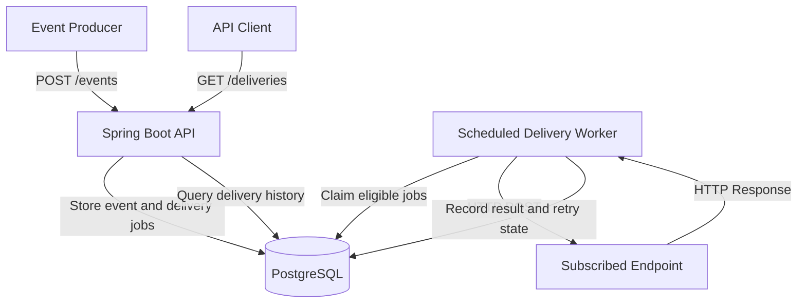

# Webhook Relay

A webhook delivery service built with Java 21, Spring Boot, and PostgreSQL.

Webhook Relay accepts events, creates delivery jobs for subscribed HTTP endpoints, and processes them asynchronously using a database-backed worker. PostgreSQL acts as both the event store and the work queue, enabling transactional event ingestion without a separate message broker.

> **Status: v0.2 released.** The local MVP now includes exponential-backoff retries, dead-letter handling, replay, event idempotency, HMAC-SHA256 signing, per-endpoint rate limiting, and HTTP reliability integration tests. A public deployment is not yet available.

## What's implemented

- **Application:** Spring Boot 4.1.1 with REST APIs, Bean Validation, Actuator, and separate `local` and `test` profiles.

- **Database:** PostgreSQL 17 managed through Docker Compose, with Flyway migrations and Spring Data JPA.

- **Endpoint registration:** Register HTTP endpoints and subscribe them to event types.

- **Event ingestion:** Accept events and create delivery jobs for subscribed endpoints within a database transaction.

- **Delivery worker:** Poll for eligible deliveries, claim jobs using `FOR UPDATE SKIP LOCKED`, and send HTTP POST requests.

- **Retry and recovery:** Retry transient failures using capped exponential backoff with full jitter, reclaim expired leases, and reject stale worker results.
- **Failure classification:** Distinguish retryable HTTP/server/transport failures from terminal errors; move exhausted or non-retryable deliveries to `DEAD`.
- **Replay:** Manually replay dead-letter deliveries through `POST /deliveries/{id}/replay` with replay-specific attempt accounting.
- **Event idempotency:** Accept an idempotency key to prevent duplicate event creation and detect conflicting reuse.
- **Webhook authentication:** Sign outgoing requests with HMAC-SHA256 and verify signatures with a timestamp freshness window and constant-time comparison.
- **Rate limiting:** Apply per-endpoint token-bucket limits and defer deliveries when capacity is exhausted without issuing an HTTP request.

- **Delivery history API:** List deliveries with status filtering, endpoint filtering, and pagination; retrieve individual deliveries with their attempt history.

- **Testing:** JUnit 5, Testcontainers, WireMock Standalone, and Awaitility tests covering database integrity, concurrency, retries, HTTP timeouts, terminal failures, signing, and rate limiting.

- **Local demo:** `scripts/demo.sh` demonstrates endpoint registration, event publishing, worker processing, and delivery history retrieval.

- **Development workflow:** Gradle Wrapper, GitHub Actions, pull requests, branch protection, and Dependabot.

## Current limitations

- No publicly deployed demo.

- Load testing and production performance benchmarks have not been completed.

- Additional features, including manual replay, configurable exponential backoff, and delivery metrics, remain on the roadmap.

- Request signing is not yet documented as a verified end-to-end feature.

## Technology

| Area | Current implementation |

| --- | --- |

| Language | Java 21 |

| Framework | Spring Boot 4.1.1 |

| Build | Gradle Wrapper |

| Database access | Spring Data JPA, Spring JDBC, PostgreSQL JDBC driver |

| Database | PostgreSQL 17 |

| Schema migrations | Flyway |

| Local infrastructure | Docker Compose |

| Health endpoint | Spring Boot Actuator |

| Testing | JUnit 5, Spring Boot Test, Testcontainers (PostgreSQL 17), WireMock Standalone, Awaitility |

| CI | GitHub Actions |

**Planned:** Micrometer/Prometheus delivery metrics, k6 load testing, and a public HTTPS deployment.

## Delivery architecture



### Delivery workflow

1\. **Endpoint registration:** Clients register an HTTP endpoint and subscribe to event types using `POST /endpoints`.

2\. **Event ingestion:** Producers publish events through `POST /events`. The application stores the event and creates delivery jobs for matching endpoints in a database transaction.

3\. **Worker polling:** A scheduled worker periodically queries PostgreSQL for eligible deliveries.

4\. **Concurrent claiming:** Workers use `SELECT ... FOR UPDATE SKIP LOCKED` to claim available jobs without claiming the same job concurrently.

5\. **HTTP delivery:** The worker sends an HTTP POST request to the registered endpoint.

6\. **Result recording:** Successful responses mark the delivery as `SUCCEEDED`. Failed attempts are recorded and eligible deliveries are scheduled for retry.

7\. **Lease recovery:** Expired worker leases allow interrupted deliveries to be reclaimed. Ownership checks prevent stale workers from overwriting newer results.

8\. **Delivery inspection:** Clients can retrieve delivery status, pagination results, and attempt history using the delivery query APIs.

### Delivery guarantee

The system follows an **at-least-once delivery model**.

A receiver may process a webhook before the worker records the successful result. If the worker crashes during this interval, the delivery can be retried.

Therefore, receivers should implement idempotent processing to handle duplicate webhook deliveries safely.

### Concurrency and reliability

- **Database-backed queue:** PostgreSQL stores both events and delivery jobs.

- **Row-level locking:** `FOR UPDATE SKIP LOCKED` enables concurrent workers to claim different jobs.

- **Lease-based recovery:** Expired leases allow unfinished work to be reclaimed.

- **Fencing checks:** Stale worker results are rejected when ownership has changed.

- **Attempt history:** HTTP status codes, errors, and durations are recorded for delivery inspection.

Worker concurrency and expired-lease recovery are covered by integration tests using PostgreSQL and Testcontainers.

## Data model

| Table | Purpose |

| --- | --- |

| `endpoints` | Destination URL, signing secret, subscribed event types, active flag, optional rate limit |

| `events` | Event type, JSON payload, optional idempotency key, creation time |

| `deliveries` | One event-to-endpoint job: status, attempt count, retry schedule, lease, latest outcome |

| `delivery_attempts` | Per-attempt HTTP status or transport error, duration, start time |

One event has many deliveries; one delivery has many attempts.

**Integrity rules enforced by the database**

- Idempotency keys are unique when present; events without a key are allowed.

- One delivery job per `(event_id, endpoint_id)` pair.

- One attempt record per `(delivery_id, attempt_no)` pair.

- Payloads must be JSON objects, stored as `jsonb`.

- Delivery status is one of `PENDING`, `IN_PROGRESS`, `SUCCEEDED`, or `DEAD`.

- A lease timestamp is required for `IN_PROGRESS` and must be empty for every other status.

- Attempt counters, HTTP status codes, and durations must fall within valid ranges.

These rules protect stored data. API-level idempotency and valid worker state transitions are also enforced in application code.

**Indexes**

| Index | Query it supports |

| --- | --- |

| `(next_attempt_at, id) WHERE status = 'PENDING'` | Find due pending deliveries |

| `(locked_until, id) WHERE status = 'IN_PROGRESS'` | Find expired worker leases |

| `(endpoint_id)` | List deliveries for an endpoint |

The partial indexes keep completed delivery history out of the active-job indexes. Their performance has not been benchmarked yet.

## Design decisions

**PostgreSQL as both store and queue.** Writing events and jobs to the same database makes transactional enqueueing possible without a separate broker. The tradeoff is polling overhead and extra database load, which will need to be measured under realistic workloads.

**Flyway owns the schema.** Applied migrations are never edited, and every schema change goes into a new version so the schema history stays reproducible. Hibernate runs with `ddl-auto=validate`, checking that JPA entities match the schema without modifying it.

**Text status with a CHECK constraint.** The database rejects unknown statuses, and new states can be added through an explicit migration. Valid transitions between states are enforced in application code.

**Sign the bytes that are sent.** `jsonb` normalizes JSON and does not preserve original input bytes. The sender signs the serialized body it actually transmits; verification uses the raw HTTP request bytes. The signature includes a timestamp and is checked with a ±5-minute freshness window.

## Run locally

**Prerequisites:** JDK 21, Git, and Docker with Compose (engine running). Ports `5432` and `8080` should be free. Commands use macOS/Linux shell syntax. PostgreSQL runs in Docker; the application runs on the host.

### 1. Clone and configure

```bash

git clone https://github.com/fxtiion-sys/webhook-relay.git

cd webhook-relay

cp .env.example .env

```

Replace the password placeholder in `.env` with a local development password. Keep the file shell-compatible, because it is sourced in step 3.

```dotenv

POSTGRES_DB=webhook_relay

POSTGRES_USER=relay

POSTGRES_PASSWORD=replace_with_local_password

POSTGRES_PORT=5432

APP_PORT=8080

```

`.env` is ignored by Git. If a database volume already exists, changing `POSTGRES_PASSWORD` does not change the stored user's password.

### 2. Start PostgreSQL

```bash

docker compose config --quiet

docker compose up -d postgres

docker compose ps

```

Wait until the `postgres` service reports `healthy`.

### 3. Start the application

```bash

set -a

source .env

set +a

./gradlew bootRun --args='--spring.profiles.active=local'

```

Docker Compose reads `.env` on its own, but the application on the host needs the values exported. Repeat the export in every new terminal.

Flyway applies migrations on startup. On a fresh database, Flyway applies the versioned migrations, including the initial schema and delivery attempt-base migration (`V3`).

### 4. Check health

```bash

curl http://localhost:8080/actuator/health

```

The response should report `UP`. Use the API examples below to register an endpoint and publish an event.

### 5. Run the end-to-end demo

The demo script creates an endpoint, publishes an event, waits for the delivery worker, and retrieves the delivery result and attempt history.

**Prerequisites:** The application and PostgreSQL must be running. Install `curl` and `jq` before running the demo.

```bash

chmod +x scripts/demo.sh

./scripts/demo.sh

```

The script performs the following steps:

1\. Registers a webhook endpoint using `POST /endpoints`.

2\. Publishes an event using `POST /events`.

3\. Waits for the delivery worker to process the event.

4\. Retrieves the delivery status and attempt history.

Expected output:

```text

\=== Webhook Relay Demo ===

[1/4] Creating endpoint...

Endpoint ID: <generated-uuid>

[2/4] Publishing event...

Event ID: <generated-uuid>

[3/4] Waiting for delivery...

Delivery ID: <generated-uuid>

Status: SUCCEEDED

[4/4] Fetching delivery details...

{

  "delivery": {

    "status": "SUCCEEDED",

    "attemptCount": 1,

    "lastStatusCode": 200

  },

  "attempts": [

    {

      "attemptNo": 1,

      "statusCode": 200

    }

  ]

}

\=== Demo completed successfully ===

```

The JSON shown above is abbreviated. Actual responses also include IDs, timestamps, and other delivery metadata.

### 6. API endpoints

| Method | Endpoint | Description |

| --- | --- | --- |

| POST | `/endpoints` | Register a webhook endpoint |

| GET | `/endpoints/{id}` | Retrieve endpoint information |

| POST | `/events` | Publish an event and create delivery jobs |

| GET | `/deliveries` | List deliveries with optional filters and pagination |

| GET | `/deliveries/{id}` | Retrieve a delivery and its attempt history |

| POST | `/deliveries/{id}/replay` | Replay an eligible dead-letter delivery |
| POST | `/mock-receiver` | Local receiver for testing HTTP delivery |

| GET | `/actuator/health` | Check application health |

#### Create an endpoint

```bash

curl -X POST http://localhost:8080/endpoints \\

  -H "Content-Type: application/json" \\

  -d '{

    "url": "http://localhost:8080/mock-receiver",

    "eventTypes": ["order.created"]

  }'

```

#### Publish an event

```bash

curl -X POST http://localhost:8080/events \\

  -H "Content-Type: application/json" \\

  -d '{

    "type": "order.created",

    "payload": {

      "orderId": 123

    }

  }'

```

#### List deliveries

```bash

curl "http://localhost:8080/deliveries?page=0&size=10"

```

Filter by status:

```bash

curl "http://localhost:8080/deliveries?status=SUCCEEDED"

```

Filter by endpoint:

```bash

curl "http://localhost:8080/deliveries?endpointId=<endpoint-uuid>"

```

#### Retrieve delivery details

```bash

curl "http://localhost:8080/deliveries/<delivery-uuid>"

```

The response includes delivery metadata and an `attempts` array ordered by attempt number.

### 7. Stop

Stop the Spring Boot application with `Ctrl+C`, then run:

```bash

docker compose stop

```

The database volume is preserved. Running `docker compose down -v` deletes the database volume and its data.

## Testing

Integration tests run against PostgreSQL 17 using Testcontainers. Docker must be running, but no manually configured test database is required.

### Run tests

Run the complete test suite:

```bash

./gradlew clean test

```

Run the full build:

```bash

./gradlew clean build

```

Run HTTP reliability integration tests only:

```bash
./gradlew test --tests '*DeliveryRetryHttpIntegrationTest'
```

Run delivery query integration tests only:

```bash

./gradlew test --tests "*DeliveryQueryIntegrationTest"

```

### Test coverage

The integration test suite covers:

- **Persistence:** JPA entity mappings, JSONB payloads, relationships, and repository operations.

- **Database schema:** Flyway migrations, foreign keys, uniqueness constraints, CHECK constraints, and indexes.

- **Event ingestion:** Event creation and transactional delivery job creation.

- **HTTP delivery:** Sending webhook requests and recording delivery outcomes.

- **Worker concurrency:** Multiple workers claiming jobs without duplicate ownership.

- **Lease recovery:** Reclaiming expired leases and rejecting stale worker results.

- **Delivery queries:** Status filtering, endpoint filtering, and pagination.

- **Delivery details:** Retrieving delivery metadata and attempt history in ascending attempt-number order.

- **Error handling:** Returning a not-found error for nonexistent deliveries.
- **Retries and terminal failures:** Real HTTP `500 → 500 → 200`, timeout → success, and `400 → DEAD` scenarios with WireMock and Awaitility.
- **Retry policy:** Capped exponential backoff with full jitter and deterministic unit tests.
- **Idempotency and replay:** Duplicate event protection, conflict handling, and dead-letter replay state transitions.
- **Signing:** HMAC-SHA256 signature generation and verification against transmitted request bytes.
- **Rate limiting:** Per-endpoint token-bucket behavior and HTTP-level delivery deferral.

The `DeliveryQueryIntegrationTest` class includes seven tests covering delivery queries, pagination, attempt history, and missing delivery handling.

### Test reports

Gradle generates an HTML test report after running the test suite.

On macOS:

```bash

open build/reports/tests/test/index.html

```

GitHub Actions also runs the Gradle build and integration tests.

### Testing limitations

- Production-scale throughput and latency have not been benchmarked.

- The delivery query tests primarily verify service-layer behavior; HTTP response behavior has also been manually tested.

- The new WireMock tests exercise selected HTTP failure paths, not every combination of replay, idempotency, signing, and rate limiting.
- Additional worker-crash, network-fault, and load tests are planned.

## Roadmap

### Completed

- [x] Spring Boot foundation, CI, and repository workflow

- [x] Local PostgreSQL with Docker Compose

- [x] Database schema, constraints, and indexes with Flyway

- [x] JPA entities and Spring Data repositories

- [x] PostgreSQL integration tests with Testcontainers

- [x] Endpoint registration API

- [x] Event ingestion with transactional delivery job creation

- [x] Asynchronous HTTP webhook delivery

- [x] Concurrent worker claiming with `FOR UPDATE SKIP LOCKED`

- [x] Retry handling for failed deliveries

- [x] Expired lease recovery and stale worker result rejection

- [x] Delivery list API with filtering and pagination

- [x] Delivery detail API with attempt history

- [x] Worker concurrency and delivery query integration tests

- [x] End-to-end demo script
- [x] Configurable exponential backoff with full jitter
- [x] Retryable/non-retryable failure classification and dead-letter handling
- [x] Manual delivery replay and event idempotency
- [x] HMAC-SHA256 signing and timestamp verification
- [x] Per-endpoint token-bucket rate limiting
- [x] WireMock/Awaitility HTTP reliability integration tests
- [x] v0.2 release

### Planned

- [ ] Configurable exponential backoff with jitter

- [ ] Manual delivery replay

- [ ] HMAC-SHA256 request signing with timestamps

- [ ] Delivery metrics and monitoring

- [ ] Reproducible load testing with k6

- [ ] Additional receiver-outage and worker-crash tests

- [ ] HTTPS demo deployment

- [ ] Delivery history UI

### Not included in v0.2

Kafka/SQS, Kubernetes, a client SDK, and multi-tenant authentication.

### Releases

- **[v0.1](https://github.com/fxtiion-sys/webhook-relay/releases/tag/v0.1):** Local MVP with event ingestion, asynchronous delivery, delivery queries, and a runnable demo.
- **[v0.2](https://github.com/fxtiion-sys/webhook-relay/releases/tag/v0.2):** Reliability and security improvements, including retry policies, dead-letter handling, replay, idempotency, signing, rate limiting, and HTTP integration tests.

Progress is tracked in [GitHub Issues](https://github.com/fxtiion-sys/webhook-relay/issues) and [Milestones](https://github.com/fxtiion-sys/webhook-relay/milestones).
