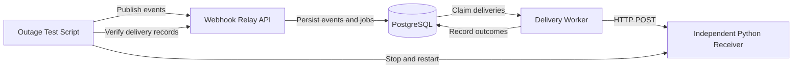

# Receiver Outage and Recovery Testing

## Overview

This document describes how Webhook Relay handles temporary receiver unavailability and recovers accepted events through its PostgreSQL-backed delivery queue and retry mechanism.

The objective is to verify that events accepted during a receiver outage remain available for delivery and can be successfully delivered after the receiver becomes available again.

## Test Objectives

- Accept events while the destination receiver is unavailable.
- Preserve accepted events and their associated delivery jobs.
- Classify connection failures as retryable transport failures.
- Record failed delivery attempts.
- Automatically retry deliveries after receiver restoration.
- Verify that no accepted event is missing from the recovered delivery set.
- Verify that no delivery enters the DEAD state during the tested scenario.

## Test Architecture

The failure-recovery test uses an independent Python HTTP receiver rather than the built-in Spring Boot mock receiver.



Separating the receiver from the application allows the destination server to be stopped and restarted without interrupting event ingestion, database access, or worker execution.

## Test Components

| File | Purpose |
| --- | --- |
| `ReceiverOutageIntegrationTest.java` | Controlled integration test covering receiver failure and recovery |
| `scripts/outage-receiver.py` | Independent HTTP receiver implemented using the Python standard library |
| `scripts/receiver-outage-test.sh` | Automated local outage simulation and recovery verification |

The Python receiver binds to the loopback interface and provides two endpoints:

| Method | Endpoint | Purpose |
| --- | --- | --- |
| GET | `/health` | Receiver availability check |
| POST | `/webhook` | Receive webhook payloads and log delivery IDs |

The receiver is a development-only testing component. It does not perform HMAC signature verification.

## Failure Scenario

### Phase 1: Receiver initialization

Start the independent receiver and verify that its health endpoint returns HTTP 200.

Register a webhook endpoint using a unique event type to isolate the test workload from previous runs.

### Phase 2: Receiver outage

Terminate the receiver process and verify that it is no longer available.

Webhook Relay and PostgreSQL remain running throughout the outage.

### Phase 3: Event ingestion

Publish 10 events while the receiver is offline.

Record every accepted event ID returned by the event ingestion API.

### Phase 4: Failed delivery attempts

Allow the delivery worker to attempt HTTP delivery.

Connection failures are classified as retryable transport failures. Failed deliveries remain eligible for retry according to the configured retry policy.

Verify that all 10 deliveries have been attempted and remain in the PENDING state before restoring the receiver.

### Phase 5: Receiver restoration

Restart the receiver on the same port.

The delivery worker continues processing eligible deliveries without requiring manual replay or an application restart.

### Phase 6: Recovery verification

Wait for all deliveries to reach SUCCEEDED.

Compare:

- Accepted event IDs.
- Event IDs associated with persisted delivery records.
- Delivery IDs returned by the delivery query API.
- Unique delivery IDs recorded by the independent receiver.

The script fails if delivery records are missing, unexpected delivery records are present, receiver-side delivery IDs do not match, or any delivery reaches DEAD.

## Observed Results

Local test executed on November 24, 2026.

| Metric | Result |
| --- | ---: |
| Accepted events | 10 |
| Successful deliveries | 10 |
| Missing deliveries | 0 |
| Dead deliveries | 0 |
| Recovery rate | 100% |

All 10 accepted events were successfully delivered after receiver restoration.

No manual replay or Webhook Relay restart was required.

The observed result demonstrates that the existing persistence and retry mechanisms successfully handled the tested temporary receiver outage.

## Integration Test

The integration test uses PostgreSQL through Testcontainers, WireMock, MockMvc, and Awaitility.

The receiver is stopped before event ingestion and restarted after failed delivery attempts have been recorded.

Automatic worker scheduling is disabled for this test so that worker execution can be controlled explicitly.

The test verifies event persistence, delivery creation, failed transport attempts, retry eligibility, successful recovery, attempt history, and receiver-side request delivery.

Run the targeted integration test:

```bash
./gradlew test --tests '*ReceiverOutageIntegrationTest'
```

Run the complete regression suite:

```bash
./gradlew clean test
```

## Reproduction Instructions

### Prerequisites

- Java 21
- Docker and Docker Compose
- Python 3
- Bash
- curl
- jq
- uuidgen
- Running PostgreSQL instance
- Running Webhook Relay application with the local profile

### Start PostgreSQL

```bash
docker compose up -d postgres
docker compose ps
```

### Start Webhook Relay

```bash
set -a
source .env
set +a

./gradlew bootRun --args='--spring.profiles.active=local'
```

### Verify application health

```bash
curl -fsS http://localhost:8080/actuator/health
```

### Execute the outage test

In a separate terminal:

```bash
./scripts/receiver-outage-test.sh
```

The script starts, stops, and restores the receiver automatically. No separate receiver process is required.

The default receiver port is 8091.

Optional configuration:

```bash
BASE_URL=http://localhost:8080 \
RECEIVER_PORT=8091 \
./scripts/receiver-outage-test.sh
```

### Expected successful output

```text
=== Outage Recovery Test PASSED ===
Accepted events:       10
Successful deliveries: 10
Missing deliveries:    0
Dead deliveries:       0
```

## Verification Evidence

The script prints the location of its temporary evidence directory after execution.

| Evidence file | Description |
| --- | --- |
| `events.txt` | Accepted event IDs |
| `deliveries.txt` | Delivery IDs returned by the API |
| `during-outage.json` | Delivery state observed during the outage |
| `after-recovery.json` | Final delivery state |
| `expected-events.txt` | Sorted accepted event IDs |
| `delivered-events.txt` | Sorted event IDs associated with delivery records |
| `received-deliveries.txt` | Unique delivery IDs recorded by the receiver |
| `receiver.log` | Receiver output and received webhook payloads |

The evidence files and generated database records are retained for inspection.

Each execution uses a unique event type and endpoint registration to isolate its delivery records.

## Reliability Design

### Durable delivery queue

Events and delivery jobs are created transactionally in PostgreSQL.

Receiver availability is therefore not required for event acceptance.

### Retryable transport failures

Connection failures do not immediately terminate delivery processing.

The failure classifier identifies transport failures as retryable, allowing the delivery worker to schedule another attempt.

### Exponential backoff with full jitter

Retries use capped exponential backoff with full jitter to reduce synchronized retry activity.

The default retry configuration uses a one-second base delay, a 30-second maximum delay, and a maximum of five attempts.

### At-least-once delivery

Webhook Relay uses an at-least-once delivery model.

A receiver may process a request successfully before the worker records the outcome. A subsequent failure can cause the request to be retried.

Receivers should therefore implement idempotent processing using stable delivery identifiers.

## Limitations

- The observed result represents a local test with 10 events.
- Recovery depends on receiver restoration before the retry budget is exhausted.
- Full jitter introduces variability in retry timing.
- The independent receiver does not verify webhook signatures.
- Receiver-side ID comparison verifies delivery completeness, not exactly-once processing.
- The outage script does not independently simulate PostgreSQL failure or worker-process termination.
- Prolonged receiver outages and additional network-fault scenarios require separate validation.
- The results do not establish production availability or durability guarantees.

## Next Steps

- Validate recovery after abrupt worker-process termination.
- Verify expired-lease reclamation under a real worker-process failure.
- Validate prolonged receiver outages and dead-letter replay.
- Document the remaining reliability limitations before the v0.3 release.