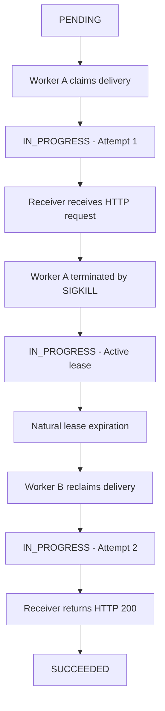

# Worker Crash Recovery

## Overview

This experiment validates the recovery of an in-flight webhook
delivery after an unexpected worker process termination.

Unlike simulated lease expiration in integration tests, this
experiment terminates a real JVM process and waits for the
database-backed lease to expire naturally.

No production Java code changes were required.

## Objectives

- Verify that a committed delivery claim survives a worker crash.
- Prevent premature reclaim while the original lease is active.
- Recover an abandoned delivery after natural lease expiration.
- Verify successful delivery by an independent worker.
- Validate delivery attempt history consistency.
- Demonstrate duplicate HTTP reception under at-least-once delivery.

## Experiment Architecture

| Component | Configuration |
|---|---|
| Worker A | Port 8081, crash-worker-a |
| Worker B | Port 8082, crash-worker-b |
| Crash receiver | Port 8092 |
| Database | Shared PostgreSQL 17 |
| Lease duration | 30 seconds |
| Worker polling delay | 500 milliseconds |
| HTTP read timeout | 2 seconds |
| First receiver response delay | 5 seconds |
| Failure injection | SIGKILL |

Both workers run as independent JVM processes using the same
Spring Boot executable JAR and PostgreSQL database.

## Failure Scenario

1. Start the crash receiver and Worker A.
2. Register a dedicated webhook endpoint.
3. Publish an event with a unique event type.
4. Worker A claims the delivery and commits the claim transaction.
5. The receiver accepts the first HTTP request and delays its response.
6. Terminate Worker A using SIGKILL before result persistence.
7. Verify that the delivery remains IN_PROGRESS with an active lease.
8. Start Worker B.
9. Verify that Worker B does not reclaim the active lease.
10. Wait for the lease to expire naturally.
11. Worker B reclaims the delivery and sends the second HTTP request.
12. Verify successful delivery and consistent attempt history.

## State Transition



## Running the Experiment

### Prerequisites

- Java 21
- Python 3
- Docker Compose
- curl
- jq
- uuidgen
- lsof
- Bash
- Configured local .env file

Use an idle local database without unfinished deliveries.

Stop any existing application instances using the experiment ports.

### Build and Run

From the repository root:

```bash
docker compose up -d postgres

./gradlew bootJar

./scripts/worker-crash-test.sh
```

The script starts and manages its own worker and receiver
processes.

PostgreSQL is not terminated during cleanup.

Experiment data remains in the local database for inspection.

## Experiment Results

Experiment date: November 24, 2026

Delivery ID:

`18e27043-d35c-465a-92d8-93f9430e7802`

Event ID:

`da652f6b-97ea-4510-8795-281fbe5c29d0`

| Validation | Expected | Observed | Result |
|---|---|---|---|
| Worker A termination | SIGKILL | SIGKILL | PASS |
| State after crash | IN_PROGRESS | IN_PROGRESS | PASS |
| Attempt count after crash | 1 | 1 | PASS |
| Lease after crash | ACTIVE | ACTIVE | PASS |
| Persisted attempts after crash | 0 | 0 | PASS |
| Premature reclaim | None | Not observed | PASS |
| Natural lease expiration | EXPIRED | EXPIRED | PASS |
| Recovery worker | Worker B | crash-worker-b | PASS |
| Final delivery status | SUCCEEDED | SUCCEEDED | PASS |
| Final attempt count | 2 | 2 | PASS |
| Final lease | NONE | NONE | PASS |
| Persisted attempt records | 1 | 1 | PASS |
| Persisted attempt number | 2 | 2 | PASS |
| Final HTTP status | 200 | 200 | PASS |
| Receiver requests | 2 | 2 | PASS |
| Delivery ID across requests | Identical | Identical | PASS |

## Database Evidence

The state format is:

```text
status|attempt_count|lease_state
```

Immediately after Worker A termination:

```text
IN_PROGRESS|1|ACTIVE
```

With Worker B running before lease expiration:

```text
IN_PROGRESS|1|ACTIVE
```

Natural lease expiration:

```text
IN_PROGRESS|1|EXPIRED
```

After successful recovery:

```text
SUCCEEDED|2|NONE
```

Persisted attempt history:

```text
2|200
```

Only the second attempt produced a persisted result.

The first claim consumed an attempt number, but the worker
terminated before saving its delivery result.

## Receiver Evidence

First request:

```json
{
  "event": "webhook_received",
  "deliveryId": "18e27043-d35c-465a-92d8-93f9430e7802",
  "requestCount": 1,
  "timestamp": 1795555245.0038831
}
```

First connection outcome:

```json
{
  "event": "connection_closed",
  "deliveryId": "18e27043-d35c-465a-92d8-93f9430e7802",
  "requestCount": 1
}
```

Second request:

```json
{
  "event": "webhook_received",
  "deliveryId": "18e27043-d35c-465a-92d8-93f9430e7802",
  "requestCount": 2,
  "timestamp": 1795555275.48483
}
```

Second connection outcome:

```json
{
  "event": "response_sent",
  "deliveryId": "18e27043-d35c-465a-92d8-93f9430e7802",
  "requestCount": 2
}
```

The payload fields have been omitted from these excerpts.

## Recovery Timing

The interval between the two receiver requests was:

```text
1795555275.48483 - 1795555245.0038831
= 30.4809469 seconds
```

Observed request-to-request interval: approximately 30.481 seconds.

This is consistent with the configured 30-second lease and
scheduled worker polling.

This measurement is not the exact time between lease expiration
and reclaim, nor a guaranteed recovery latency.

## Worker Recovery Log

```text
event=delivery_processed
workerId=crash-worker-b
deliveryId=18e27043-d35c-465a-92d8-93f9430e7802
attempt=2
httpStatus=200
```

The log confirms that Worker B processed the recovered delivery.

## Reliability Mechanisms

### Durable Claims

The claim transaction commits before outbound HTTP execution.

Consequently, the delivery remains in PostgreSQL even when
the claiming JVM terminates unexpectedly.

### Lease-Based Recovery

An active lease prevents other workers from reclaiming the
delivery.

Once the lease expires, another worker can reclaim the
abandoned delivery, subject to the configured attempt limit.

### Result Fencing

Result persistence validates the current attempt number and
lease identity.

After a delivery is reclaimed, an outdated worker cannot
overwrite the newer claim's result.

Stale-result rejection is covered by the existing
expiredLeaseShouldBeReclaimedAndStaleResultRejected
integration test.

The process-level experiment does not independently simulate
a stale worker returning after reclaim.

### At-Least-Once Delivery

The receiver observed two HTTP requests with the same
delivery ID.

A worker can terminate after the receiver accepts a request
but before the delivery result is persisted.

The relay cannot determine whether the receiver already
performed its business operation.

Therefore, duplicate delivery is possible.

Consumers should use the stable Webhook-Id header as an
idempotency key and persist processed identifiers when
implementing deduplication.

Exactly-once external side effects are not guaranteed.

### Attempt History

The attempt counter represents claimed delivery attempts.

The delivery_attempts table records persisted attempt results.

A crashed worker may consume an attempt number without
creating an attempt history record.

In this experiment:

- Claimed attempts: 2
- Persisted attempt results: 1
- Receiver requests: 2

This difference is expected.

## Automated Test Coverage

Added integration test:

`activeLeaseShouldPreventPrematureReclaim()`

The test verifies:

- Committed claim visibility in a separate transaction.
- IN_PROGRESS status after claiming.
- Active lease persistence.
- Absence of an attempt result before result persistence.
- Prevention of premature reclaim.
- Preservation of the attempt count and lease identity.

Existing integration tests cover expired lease recovery,
stale-result rejection, and exhausted attempt handling.

## Regression Test Results

Executed:

```bash
./gradlew clean test
```

Results verified using Gradle XML reports:

| Metric | Result |
|---|---:|
| Total tests | 107 |
| Passed | 107 |
| Failures | 0 |
| Errors | 0 |
| Skipped | 0 |
| Pass rate | 100% |
| Build duration | 41 seconds |

## Evidence Artifacts

The experiment preserves the following files in a temporary
evidence directory:

| File | Purpose |
|---|---|
| worker-a.log | Original worker execution |
| worker-b.log | Recovery worker execution |
| receiver.log | HTTP reception and connection outcomes |
| event-response.json | Event publication response |
| after-crash.txt | State immediately after termination |
| before-expiry.txt | Active lease verification |
| after-recovery.txt | Final delivery state |
| attempt-history.txt | Persisted attempt results |
| recovery-worker.txt | Recovery worker identification |

## Limitations

- This experiment validates one controlled worker crash.
- The database and receiver remain available during recovery.
- Recovery timing depends on lease duration and worker polling.
- Worker B must start before the original lease expires to
  demonstrate active lease protection.
- The crash trigger depends on detecting the receiver log
  before the HTTP client times out.
- Duplicate HTTP requests remain possible.
- Recovery is subject to the configured maximum attempt count.
- This experiment does not establish production availability
  guarantees or exactly-once delivery.

## Conclusion

The experiment successfully demonstrated that a webhook
delivery survives an unexpected JVM termination and can be
recovered by an independent worker after natural lease
expiration.

The recovered delivery reached SUCCEEDED with consistent
attempt history and a cleared lease.

All 107 automated tests passed without failures, errors,
or skipped tests.